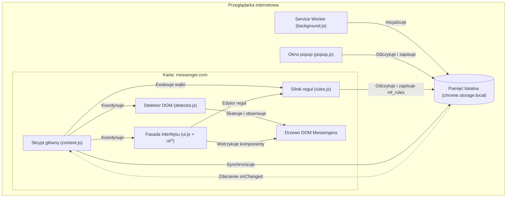
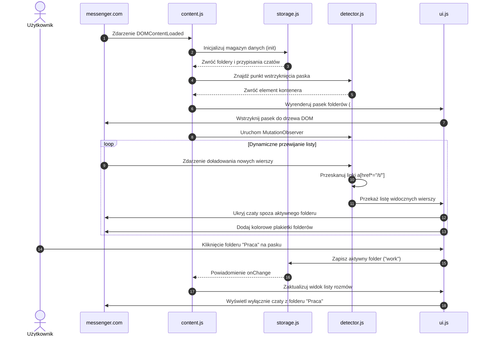

# Architektura techniczna Messenger Folders

> Poznaj architekturę techniczną, przepływ danych oraz mechanizmy odporności wtyczki na zmiany w serwisie Messenger.

Dokument opisuje budowę wewnętrzną rozszerzenia Messenger Folders.
Wyjaśnia sposób integracji z interfejsem Messengera, strukturę danych oraz obsługę dynamicznego kodu HTML.

---

## Spis treści

- [Przegląd architektury](#przegląd-architektury)
- [Struktura modułów](#struktura-modułów)
- [Moduł pamięci (Storage)](#moduł-pamięci-storage)
- [Moduł detektora DOM (Detector)](#moduł-detektora-dom-detector)
- [Silnik reguł automatycznego przypisywania (Rules)](#silnik-reguł-automatycznego-przypisywania-rules)
- [Odporność na dynamiczne klasy CSS Messengera](#odporność-na-dynamiczne-klasy-css-messengera)
- [Obsługa wirtualnego przewijania (MutationObserver)](#obsługa-wirtualnego-przewijania-mutationobserver)
- [Warstwa interfejsu użytkownika (UI)](#warstwa-interfejsu-użytkownika-ui)
- [Diagram przepływu danych](#diagram-przepływu-danych)
- [Testy jednostkowe](#testy-jednostkowe)
- [Testy E2E (Playwright)](#testy-e2e-playwright)

---

## Przegląd architektury

Wtyczka wykorzystuje najnowszy standard rozszerzeń **Manifest V3**.
Działa wyłącznie w środowisku przeglądarki użytkownika.
Nie komunikuje się z żadnymi zewnętrznymi serwerami ani usługami API.

Architektura opiera się na czterech głównych filarach:
1. **Content Scripts**: Skrypty wstrzykiwane bezpośrednio do stron Messengera.
2. **Background Service Worker**: Skrypt tła zarządzający cyklem życia i inicjalizacją danych.
3. **Popup Interface**: Okno podręczne do konfiguracji folderów oraz tworzenia kopii zapasowych.
4. **Chrome Storage Local**: Szybka i bezpieczna pamięć lokalna przeglądarki.



---

## Struktura modułów

Tabela przedstawia pliki wchodzące w skład rozszerzenia:

| Plik | Rola techniczna | Odpowiedzialność |
| :--- | :--- | :--- |
| [manifest.json](../manifest.json) | Plik manifestu | Deklaruje uprawnienia, skrypty oraz punkty wejścia. |
| [background/background.js](../background/background.js) | Service Worker | Inicjalizuje domyślne foldery po instalacji rozszerzenia. |
| [src/storage.js](../src/storage.js) | Warstwa danych | Zarządza strukturą folderów i przypisaniami wątków. |
| [src/detector.js](../src/detector.js) | Silnik detekcji DOM | Odnajduje czaty, linki i punkty wstrzyknięcia interfejsu. |
| [src/rules.js](../src/rules.js) | Silnik reguł | Przechowuje reguły (`mf_rules`) i dopasowuje do nich wątki. |
| [src/ui.js](../src/ui.js) | Fasada interfejsu | Klasa `MessengerUI` (alias `MessengerFoldersUI`) deleguje pracę do modułów `src/ui/*`. |
| [src/ui/core.js](../src/ui/core.js) | Baza interfejsu | Stałe, ikony SVG (`ICONS`), bezpieczne wstawianie do DOM, powiadomienia toast. |
| [src/ui/folder-bar.js](../src/ui/folder-bar.js) | Pasek folderów | Dwurzędowy pasek `#mf-folder-bar`: wyszukiwarka, pigułki, przewijanie, liczniki. |
| [src/ui/folder-modal.js](../src/ui/folder-modal.js) | Okno folderu | Tworzenie i edycja folderu: nazwa, emoji, kolor, wybór rozmów. |
| [src/ui/thread-menu.js](../src/ui/thread-menu.js) | Menu wątku | Menu przypisania, plakietka w wierszu czatu, pigułka w nagłówku rozmowy. |
| [src/ui/settings-modal.js](../src/ui/settings-modal.js) | Okno ustawień | Zakładki: foldery, rozmowy, kopia zapasowa oraz reguły z edytorem. |
| [src/content.js](../src/content.js) | Koordynator strony | Łączy detektor, pamięć, silnik reguł oraz interfejs na karcie Messengera. |
| [src/content.css](../src/content.css) | Arkusz stylów | Nadaje wygląd komponentom i wspiera motyw ciemny. |
| [popup/popup.js](../popup/popup.js) | Logika okna popup | Obsługuje edycję folderów oraz eksport i import JSON. |
| [tests/test_storage_detector.js](../tests/test_storage_detector.js) | Testy jednostkowe | Sprawdza magazyn danych, detektor i funkcje koordynatora. |
| [tests/test_ui.js](../tests/test_ui.js) | Testy jednostkowe | Sprawdza warstwę interfejsu na atrapach DOM. |
| [tests/test_rules.js](../tests/test_rules.js) | Testy jednostkowe | Sprawdza operatory, priorytety, ochronę regex i zapis reguł. |

Skrypty zawartości ładują się w kolejności z `manifest.json`: `src/storage.js`, `src/detector.js`,
`src/rules.js`, `src/ui/core.js`, `src/ui/folder-bar.js`, `src/ui/folder-modal.js`,
`src/ui/thread-menu.js`, `src/ui/settings-modal.js`, `src/ui.js`, `src/content.js`. Moduły nie używają `import` — każdy rejestruje
swoją klasę w `globalThis` (i w `module.exports` dla testów w Node), a następne pliki ją odczytują.

---

## Moduł pamięci (Storage)

Klasa [`MessengerFoldersStorage`](../src/storage.js#L30-L580) w pliku [src/storage.js](../src/storage.js) zarządza danymi użytkownika.
Wszystkie operacje wykonuje asynchronicznie za pośrednictwem interfejsu `chrome.storage.local`.

### Model danych

Pamięć przechowuje dane pod trzema stałymi kluczami:

```javascript
// Klucze w chrome.storage.local
const STORAGE_KEYS = {
  FOLDERS: 'mf_folders',          // Lista obiektów folderów
  ACTIVE_FOLDER: 'mf_active_folder', // Identyfikator wybranego folderu
  THREADS: 'mf_threads',          // Mapa przypisań czatów
};
```

1. **Lista folderów (`mf_folders`)**:
   Tablica obiektów definiujących foldery:
   ```json
   [
     { "id": "all", "name": "Wszystkie", "icon": "💬", "color": "#0084FF", "isSystem": true },
     { "id": "work", "name": "Praca", "icon": "💼", "color": "#10B981", "isSystem": false },
     { "id": "uncategorized", "name": "Inne", "icon": "📁", "color": "#6B7280", "isSystem": true }
   ]
   ```
   System blokuje usuwanie folderów systemowych `all` oraz `uncategorized`.

2. **Aktywny folder (`mf_active_folder`)**:
   Pojedynczy identyfikator tekstowy (np. `"work"` lub `"all"`).

3. **Mapa czatów (`mf_threads`)**:
   Słownik łączący unikalny identyfikator wątku z danymi folderu:
   ```json
   {
     "1000123456789": {
       "folderId": "work",
       "name": "Jan Kowalski",
       "avatar": "https://...",
       "assignedAt": 1728500000000,
       "updatedAt": 1728500000000,
       "autoAssigned": true
     }
   }
   ```
   Pole `autoAssigned` ma wartość `true`, gdy przypisanie wykonała reguła
   (metoda `applyAutoAssignments`, opis w sekcji o silniku reguł).

Reguły automatycznego przypisywania leżą pod osobnym kluczem `mf_rules`, którym zarządza
[src/rules.js](../src/rules.js). Eksport i import JSON obejmują tylko foldery i przypisania — bez reguł.

### Synchronizacja w czasie rzeczywistym

Moduł nasłuchuje zdarzenia `chrome.storage.onChanged`.
Gdy zmienisz folder w oknie popup, wtyczka natychmiast odświeża interfejs w otwartej karcie Messengera.
Nie musisz przeładowywać strony po dodaniu nowego folderu.

---

## Moduł detektora DOM (Detector)

Klasa [`MessengerDOMDetector`](../src/detector.js#L14-L511) w pliku [src/detector.js](../src/detector.js) odnajduje elementy w drzewie strony.
Przekształca surowe elementy HTML w uporządkowane obiekty wątków.

### Rozpoznawanie identyfikatorów wątków

Metoda `extractThreadIdFromUrl(url)` analizuje adresy URL i wyciąga stabilne ID rozmowy.
Obsługuje wszystkie znane warianty linków na Messengerze i Facebooku:

- Standardowe czaty: `/t/1000123456789`
- Czaty w serwisie Facebook: `/messages/t/1000123456789`
- Czaty szyfrowane E2EE: `/e2ee/t/1000123456789`
- Parametry zapytania: `?selected_item_id=1000123456789`

### Wyszukiwanie punktu wstrzyknięcia paska

Metoda `findFolderBarInjectionPoint()` automatycznie lokalizuje najlepsze miejsce na pasek folderów:
1. Sprawdza obszar bezpośrednio pod polem wyszukiwania kontaktów.
2. Jeśli pole nie istnieje, sprawdza nagłówek listy czatów.
3. W ostateczności umieszcza pasek nad pierwszym widocznym wierszem rozmowy.

Dzięki temu pasek pojawia się zawsze w logicznym miejscu, niezależnie od wersji interfejsu.

---

## Silnik reguł automatycznego przypisywania (Rules)

Klasa `MessengerRulesEngine` w pliku [src/rules.js](../src/rules.js) przechowuje reguły
i dopasowuje do nich wątki. Nie dotyka DOM — dane wątków dostaje od koordynatora
[src/content.js](../src/content.js), a edytor reguł jest częścią
[src/ui/settings-modal.js](../src/ui/settings-modal.js) (zakładka **⚡ Reguły**).

### Model danych reguły

Reguły leżą w `chrome.storage.local` pod kluczem `mf_rules` jako tablica obiektów:

```json
{
  "id": "rule_1728500000000_ab12c",
  "name": "Projekty firmowe",
  "enabled": true,
  "priority": 10,
  "folderId": "work",
  "matchMode": "all",
  "conditions": [
    { "field": "name", "operator": "contains", "value": "Projekt, Budowa" },
    { "field": "threadId", "operator": "regex", "value": "^1000\\d+$" }
  ],
  "overwriteManual": false,
  "createdAt": 1728500000000,
  "updatedAt": 1728500000000
}
```

Każdy odczyt i zapis przechodzi przez normalizację (`normalizeRule`, `normalizeCondition`):
- `field`: `name` albo `threadId`; starszy alias `threadName` zamienia się na `name`.
- `operator`: `contains`, `startsWith`, `endsWith`, `exact` (alias `equals`) lub `regex`;
  nieznany operator zamienia się na `contains`.
- `priority`: liczba albo niepusty tekst liczbowy (`parsePriority`), w innym razie `10`.
  Edytor proponuje zakres 0–100. Niższa wartość oznacza wyższy priorytet.
- `matchMode`: `all` (wszystkie warunki) albo `any` (dowolny warunek).
- `name` jest przycinana do 50 znaków; brak `id` oznacza wygenerowanie nowego.

### Ewaluacja

`evaluateThread(thread, rules, folders)` zwraca identyfikator folderu albo `null`:
1. Odrzuca reguły wyłączone, bez warunków, bez folderu docelowego oraz — gdy zna listę folderów —
   wskazujące nieistniejący folder.
2. Sortuje reguły rosnąco po priorytecie — wygrywa pierwsza pasująca.
3. Bez `overwriteManual` pomija wątki, które mają już folder inny niż `uncategorized`.
4. Porównuje tekst bez rozróżniania wielkości liter. W `contains` przecinek rozdziela
   alternatywne wartości.

Koordynator [src/content.js](../src/content.js) uruchamia ewaluację (`evaluateRulesNonBlocking`)
przy starcie, po mutacjach listy czatów, po nawigacji SPA, po zapisie w edytorze reguł
(`ui.onRulesChanged`) i po zmianie `mf_rules` w `chrome.storage.onChanged`:
- Tylko jedna ewaluacja naraz; kolejne wywołanie ustawia flagę i uruchamia się po zakończeniu bieżącego.
- Pamięć podręczna (do 1000 kluczy `threadId:nazwa:wersjaReguł`) pomija wątki już ocenione.
- Wątki są przetwarzane porcjami po 20; między porcjami skrypt oddaje sterowanie
  przeglądarce (`requestIdleCallback`), aby nie blokować przewijania.
- Wynik zapisuje jedna operacja `storage.applyAutoAssignments()`. Metoda aktualizuje pamięć
  podręczną magazynu przed zapisem i pomija wątki, których folder zmienił się w trakcie
  ewaluacji — ręczne przypisanie zrobione w tym czasie wygrywa z regułą.

### Ochrona wyrażeń regularnych

Operator `regex` wykonuje wzorzec użytkownika w skrypcie zawartości, a JavaScript nie pozwala
przerwać trwającego dopasowania. Źle zbudowany wzorzec mógłby więc zablokować kartę Messengera
(ReDoS). Ochronę daje `validateRegexPattern()` w `src/rules.js`, a dokładniej analiza struktury
wzorca w `analyzeRegexPattern()`. Funkcja zwraca komunikat po polsku albo `null` i odrzuca wzorzec,
gdy:
- jest dłuższy niż `MAX_REGEX_PATTERN_LENGTH` (250 znaków),
- powtarza zmienną liczbę razy grupę z alternatywą albo zmiennym kwantyfikatorem, np. `(a|a)*$`,
  `(a|ab)*c`, `(a+)+`, `((a*)b)*`, `(?:a|b)+` (nawrót wykładniczy przy każdej długości tekstu),
- ma kwantyfikator tuż po kwantyfikatorze, np. `a++` (leniwe `*?`, `+?`, `??`, `{n,m}?` są poprawne),
- przekracza budżet kosztu dla nazwy długości `REGEX_REFERENCE_TEXT_LENGTH` (100 znaków),
- nie kompiluje się (`SyntaxError` jest przechwytywany).

**Budżet kosztu** nie opiera się na liście znanych złych wzorców. `analyzeRegexPattern()` liczy
dwie wartości. Pierwsza to „punkty wyboru”: każdy `?` i każdy `|` podwaja liczbę ścieżek, a
skończone `{n,m}` dodaje log2(m−n+1). Grupa powtórzona stałą liczbę razy, np. `(\d{1,3}\.){3}`,
mnoży swoje punkty. Druga wartość to liczba nieograniczonych powtórzeń `*`, `+`, `{n,}`.
`estimateRegexCostLog2()` szacuje koszt jako
`2^punkty × C(n + u, u + 1)` (≈ n^(u+1) / (u+1)!) dla tekstu długości n i u powtórzeń.
Kotwica `^` bez `|` na najwyższym poziomie zdejmuje jeden czynnik n, bo dopasowanie ma jedną
pozycję startu. Koszt nie może przekroczyć `MAX_REGEX_COST_LOG2` (2·10⁶ kroków; w V8 to najwyżej
ok. 50 ms w najgorszym przypadku). Przykłady:
- `a?`×40+`b` i `(a|aa)`×41+`b` są odrzucane,
- `.*foo.*bar.*` jest odrzucany (3 powtórzenia), a równoważne przy `test()` `foo.*bar` jest przyjmowane,
- `^\d+-\d+-\d+$` (zakotwiczony) jest przyjmowany.

`matchCondition` nie obcina tekstu. Dla wzorca, który przeszedł walidację, sprawdza koszt dla
rzeczywistej długości tekstu i zwraca `false` tylko wtedy, gdy tekst jest dłuższy, niż budżet
przewiduje. Dla jednego powtórzenia (np. `ticket-\d+$`) granica to ok. 2000 znaków, dla dwóch
ok. 230 znaków. Nazwy wątków są znacznie krótsze. Analizy wzorców są przechowywane w pamięci
podręcznej, bo `matchCondition` jest wywoływane dla każdego wątku przy każdym skanie.

Walidacja działa w trzech miejscach:
- edytor reguł (`src/ui/settings-modal.js`) pokazuje komunikat pod warunkiem (`role="alert"`,
  `textContent`) i nie zapisuje reguły,
- `saveRule()` rzuca wyjątek dla każdego niepoprawnego wzorca w zapisywanej regule,
- `saveRules()` rzuca wyjątek dla nowych i zmienionych wzorców. Wzorzec zapisany wcześniej (ta sama
  reguła i wartość) nie blokuje przełączania ani usuwania innych reguł, a `matchCondition` i tak
  go nie wykona.

---

## Odporność na dynamiczne klasy CSS Messengera

Firma Meta regularnie przebudowuje kod Messengera za pomocą kompilatorów stylów (np. StyleX).
Kompilatory tworzą losowe, zminifikowane klasy CSS (np. `x1n2onr6 x1ja2u2z xh8yej3`).
Klasy te zmieniają się z każdą aktualizacją serwisu.
Tradycyjne wtyczki oparte na selektorach klas szybko przestają działać.

Messenger Folders stosuje strategię pełnej odporności.
Kod nie używa żadnych losowych klas CSS generowanych przez Meta.

### 5 filarów odporności wtyczki

1. **Niezmienne wzorce adresów URL**:
   Wtyczka wyszukuje elementy za pomocą selektora linków:
   ```javascript
   doc.querySelectorAll('a[href*="/t/"]')
   ```
   Struktura odnośników do czatów pozostaje niezmienna od lat.

2. **Semantyczne role ARIA i dostępność (WCAG)**:
   Meta musi wspierać czytniki ekranu dla osób z niepełnosprawnościami.
   Wiersze czatów posiadają trwałe atrybuty semantyczne:
   ```javascript
   linkElement.closest('[role="row"], [role="listitem"], li')
   ```
   Standardy dostępności gwarantują stabilność tych selektorów.

3. **Uniwersalne atrybuty układu tekstu**:
   Nazwy kontaktów znajdują się zawsze w kontenerach z atrybutem kierunku tekstu:
   ```javascript
   rowElement.querySelectorAll('span[dir="auto"]')
   ```
   Atrybut `dir="auto"` zapewnia poprawną obsługę wielu języków.

4. **Trwałe atrybuty własne (`data-mf-*`)**:
   Po wykryciu wiersza czatu detektor nadaje mu własny atrybut:
   ```javascript
   rowElement.setAttribute('data-mf-thread-id', threadId);
   ```
   Kolejne operacje filtrowania odwołują się już bezpośrednio do atrybutu wtyczki.

5. **Własna przestrzeń nazw CSS**:
   Wszystkie komponenty interfejsu wtyczki mają przedrostek `mf-` (np. `#mf-folder-bar`, `.mf-folder-pill`).
   Żaden styl wtyczki nie koliduje z oryginalnym kodem Messengera.

---

## Obsługa wirtualnego przewijania (MutationObserver)

Messenger stosuje technikę wirtualnego przewijania (ang. *virtual scrolling*).
W drzewie DOM znajdują się tylko te czaty, które aktualnie mieszczą się na ekranie.
Podczas przewijania przeglądarka usuwa niewidoczne elementy i wstawia nowe wiersze.

Aby zapewnić płynne działanie, detektor tworzy obiekt `MutationObserver`:
- Obserwuje dodawanie i usuwanie węzłów w elemencie `document.body`.
- Wykorzystuje technikę dławienia wywołań (**throttling**) z interwałem 250 ms.
- Chroni procesor przed nadmiernym obciążeniem podczas szybkiego przewijania listy.
- Błyskawicznie oznacza nowo doładowane wiersze czatów i stosuje aktywny filtr przy użyciu pamięci podręcznej (bez odpytywania pamięci `chrome.storage.local`).
- Pasek folderów jest wstrzykiwany tylko w razie potrzeby (przy starcie lub gdy kontener zostanie usunięty przez SPA).

---

## Warstwa interfejsu użytkownika (UI)

Interfejs jest podzielony na moduły w katalogu `src/ui/`. Plik [src/ui.js](../src/ui.js) to
fasada: klasa `MessengerUI` (eksportowana też jako `MessengerFoldersUI`) tworzy komponenty,
przekazuje im siebie jako kontekst (`storage`, `detector`, `rulesEngine`, callbacki) i deleguje
do nich metody publiczne. Koordynator [src/content.js](../src/content.js) zna tylko fasadę.

| Moduł | Eksport | Odpowiedzialność |
| :--- | :--- | :--- |
| [src/ui/core.js](../src/ui/core.js) | `MessengerUICore` (obiekt) | Stałe, ikony `ICONS`, `_escapeHtml`, wstawianie ikon bez zmiennych w `innerHTML`, `ToastManager`. |
| [src/ui/folder-bar.js](../src/ui/folder-bar.js) | `FolderBarComponent` | Pasek `#mf-folder-bar`, aktualizacja pigułek w miejscu, liczniki rozmów i nieprzeczytanych. |
| [src/ui/folder-modal.js](../src/ui/folder-modal.js) | `FolderModalComponent` | Okno `.mf-modal`: nazwa z podglądem, emoji, paleta kolorów, wybór rozmów. |
| [src/ui/thread-menu.js](../src/ui/thread-menu.js) | `ThreadMenuComponent` | Menu `.mf-dropdown-menu` z pozycjonowaniem, plakietka wiersza, pigułka nagłówka. |
| [src/ui/settings-modal.js](../src/ui/settings-modal.js) | `SettingsModalComponent` | Okno `.mf-modal-wide` z zakładkami: foldery, rozmowy, kopia zapasowa, reguły. |

Sama fasada zachowuje logikę wspólną dla komponentów: filtrowanie wierszy czatów
(`filterChatRows`), globalne zdarzenia (zamykanie menu i okien) oraz powiadomienia (`showToast`).

Elementy widoczne dla użytkownika:

- **Moduł paska folderów (`#mf-folder-bar`)**:
  Dwurzędowy kontener umieszczony nad listą czatów:
  - **Górny wiersz (`.mf-folder-top-bar`)**: zawiera pole wyszukiwarki folderów w czasie rzeczywistym oraz przypięty obok przycisk ustawień `⚙️`.
  - **Dolny wiersz (`.mf-folder-pills-row`)**: poziomy pasek pigułek z płynnym przewijaniem za pomocą kółka myszy, gestu dotykowego lub bocznych strzałek.
- **Wskaźnik w nagłówku (`.mf-header-pill`)**:
  Pigułka umieszczona u góry aktywnej konwersacji. Ułatwia szybką zmianę kategorii.
- **Menu wyboru folderu (`.mf-dropdown-menu`)**:
  Wyskakujące menu z wbudowaną wyszukiwarką.
  Inteligentnie dopasowuje swoją pozycję, aby nie wychodzić poza krawędź ekranu.
- **Okno edycji i zarządzania folderami (`.mf-modal`, `.mf-settings-modal`)**:
  Centrum zarządzania folderami, przypisywania czatów, wyboru emoji i kolorów, kopii zapasowej
  oraz reguł automatycznego przypisywania (zakładka **⚡ Reguły** z edytorem i podglądem liczby
  pasujących czatów).

### Zgodność z motywem jasnym i ciemnym

Plik [src/content.css](../src/content.css) pobiera wartości kolorów bezpośrednio ze zmiennych środowiskowych Meta:
- `--surface-background`
- `--primary-text`
- `--secondary-text`
- `--hover-overlay`

Dodatkowo styl nasłuchuje reguły `@media (prefers-color-scheme: dark)` oraz klasy `.__fb-dark-mode`.
Interfejs wtyczki wygląda naturalnie i spójnie w każdym motywie Messengera.

---

## Diagram przepływu danych

Poniższy diagram sekwencyjny ilustruje cykl życia wtyczki od załadowania strony po filtrowanie czatów:



---

## Testy jednostkowe

Projekt zawiera zautomatyzowane testy w plikach [tests/test_storage_detector.js](../tests/test_storage_detector.js),
[tests/test_ui.js](../tests/test_ui.js) i [tests/test_rules.js](../tests/test_rules.js).
Testy nie wymagają zewnętrznych bibliotek i uruchamiają się bezpośrednio w środowisku Node.js.

### Zakres testów

1. **Walidacja pliku manifestu**:
   Sprawdza poprawność pól `manifest_version`, `permissions`, `host_permissions` oraz ścieżek do plików.
2. **Magazyn danych (`MessengerFoldersStorage`)**:
   - Inicjalizacja folderów startowych.
   - Tworzenie, edycja i usuwanie folderów użytkownika.
   - Blokada usuwania folderów systemowych.
   - Bezpieczne przenoszenie czatów z usuwanego folderu do kategorii `uncategorized`.
   - Przypisywanie i odpinanie wątków.
   - Eksport i import danych w formacie JSON.
   - Obsługa funkcji zwrotnych `onChange`.
3. **Detektor DOM (`MessengerDOMDetector`)**:
   - Rozpoznawanie wszystkich wariantów adresów URL wątków.
   - Odróżnianie znaczników czasu i liczników od nazwisk kontaktów.
4. **Silnik reguł (`MessengerRulesEngine`)**:
   - Operatory, tryby `all`/`any`, priorytety (w tym `0`) i reguły wyłączone.
   - Odrzucanie niepoprawnych i niebezpiecznych wyrażeń regularnych.
   - Ochrona ręcznych przypisań oraz zapis reguł w `chrome.storage.local`.

### Uruchomienie testów

Aby uruchomić testy jednostkowe, wykonaj polecenie w katalogu projektu:

```bash
npm test
```

Wynik testów potwierdza pełną sprawność logiki biznesowej rozszerzenia.

## Testy E2E (Playwright)

Testy E2E ładują rozpakowane rozszerzenie do bezgłowego Chromium (`playwright.config.js`) i
uruchamiają je na statycznej, zanonimizowanej kopii DOM Messengera
([tests/fixtures/messenger.html](../tests/fixtures/messenger.html)). Moduł
[tests/e2e/helpers.js](../tests/e2e/helpers.js) przechwytuje adresy `https://www.messenger.com/**`
i blokuje każde inne żądanie, więc testy działają w 100% offline. Wyniki Playwright trafiają do
`node_modules/.cache/playwright-results`.

| Scenariusze | Zakres |
|---|---|
| E2E-01…03 | wstrzyknięcie paska, modal tworzenia folderu, przełączanie aktywnego folderu |
| E2E-04…05 | przypisanie wątku z menu kontekstowego, filtrowanie listy czatów |
| E2E-06…08 | trwałość stanu po przeładowaniu, współpraca z wyszukiwarką Messengera, usuwanie folderu |
| E2E-09 | zero żądań sieciowych |
| E2E-10…14 | reguły automatycznego przypisywania: tworzenie, start z regułami, priorytety, ręczne przypisania, niepoprawne i ReDoS-owe wyrażenia regularne |

```bash
npm run test:e2e
```

Testy E2E nie są częścią `npm run verify` (wymagają przeglądarki Playwright).
